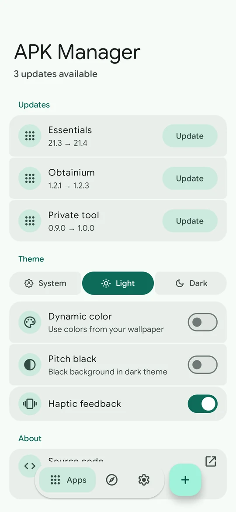
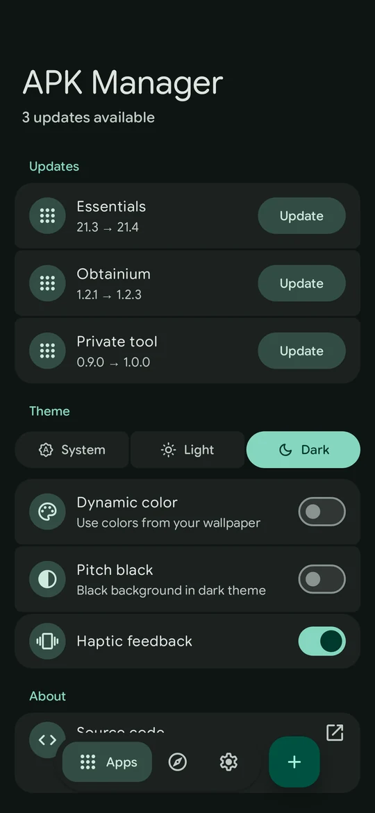
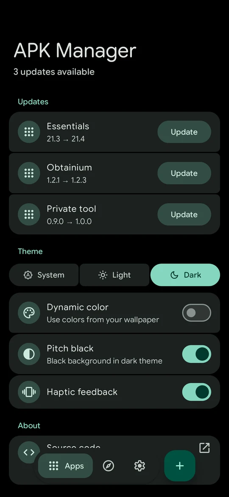

# APK Manager

> Track Android apps published on GitHub Releases and keep them up to date — including apps from **private repositories**.

APK Manager is an open-source Android app built with Kotlin, Jetpack Compose and **Material 3 Expressive**.
Add a GitHub repository, and APK Manager watches its releases, picks the right APK for your device,
verifies it and installs updates for you, optionally fully automatically in the background.

> [!NOTE]
> APK Manager is in **early development**. Early pre-releases are available on the [Releases](https://github.com/SilberGecko6917/APK-Manager/releases) page. See the [roadmap](docs/ROADMAP.md).

## Features

Planned for the first releases:

- **Track apps from GitHub Releases.** Paste a repository URL or `owner/repo`, preview its releases and pick the APK asset.
- **Sign in with GitHub** (OAuth device flow, no server involved) for 5,000 instead of 60 API requests per hour.
  - **Private repositories:** opt in to private repo access, or use a fine-grained personal access token limited to the repos you choose.
  - Live rate limit display.
- **Smart asset selection.** Matches your device ABI (`arm64-v8a`, `armeabi-v7a`, …), falls back to universal APKs, and supports include/exclude regex filters per app.
- **Safe installs.** Before installing, APK Manager checks the SHA-256 digest, package name, version code (no silent downgrades) and **signing certificate**.
- **Background update checks** with notifications, using WorkManager, ETag caching and batched GraphQL queries to stay well within rate limits.
- **Automatic updates.** Unattended updates on Android 12+ for apps installed through APK Manager. Optional Shizuku and root backends.
- **Material 3 Expressive design.** Material You dynamic color, custom seed colors, AMOLED black theme, flexible top app bars, floating toolbar navigation and grouped rounded cards.
- **Import / export**, including Obtainium exports.

Later: more sources (Codeberg/Forgejo, GitLab, F-Droid repositories) and a **Discover** tab backed by a community catalog.

## Screenshots

The design system so far (light, dark and pitch black):

<p>
  
  
  
</p>

## Download

Signed APKs are published on the [Releases](https://github.com/SilberGecko6917/APK-Manager/releases) page. Each release lists the APK's SHA-256 checksum and the signing certificate fingerprint, so you can verify the download.

## Requirements

- Android 8.0 (API 26) or newer.
- Silent/unattended updates without root require Android 12 or newer (see [architecture notes](docs/ARCHITECTURE.md#automatic-updates)).

## Permissions

| Permission | Why |
|---|---|
| `INTERNET` | Talk to the GitHub API and download releases. |
| `REQUEST_INSTALL_PACKAGES` | Install and update APKs. |
| `UPDATE_PACKAGES_WITHOUT_USER_ACTION` | Unattended updates (Android 12+) for apps installed through APK Manager. |
| `QUERY_ALL_PACKAGES` | Detect which tracked apps are installed and compare their versions. APK Manager is not distributed through Google Play. |
| `POST_NOTIFICATIONS` | Update and download notifications. |
| `FOREGROUND_SERVICE`, `FOREGROUND_SERVICE_DATA_SYNC` | Keep a download running while you use another app. |

## Building

Requirements: JDK 21 and the Android SDK.

```bash
git clone https://github.com/SilberGecko6917/APK-Manager.git
cd APK-Manager
./gradlew assembleDebug
```

See [CONTRIBUTING.md](CONTRIBUTING.md) for the development workflow and [docs/RELEASING.md](docs/RELEASING.md) for releases.

## Contributing

Contributions are welcome! Please read [CONTRIBUTING.md](CONTRIBUTING.md) and the [Code of Conduct](CODE_OF_CONDUCT.md) first.
Security issues: see [SECURITY.md](SECURITY.md).

## Acknowledgements

- The visual language is inspired by [Essentials](https://github.com/sameerasw/essentials) by Sameera Sandakelum (MIT License).
- Typeface: [Google Sans Flex](https://github.com/googlefonts/googlesans-flex) (SIL Open Font License 1.1), see [third_party](third_party/README.md).
- Icons: [Material Symbols](https://fonts.google.com/icons) (Apache License 2.0).
- Installs without confirmation through [Shizuku](https://github.com/RikkaApps/Shizuku-API) (Shizuku API, MIT License).
- The idea of tracking apps directly from their source is inspired by [Obtainium](https://github.com/ImranR98/Obtainium).

## License

APK Manager is free software, licensed under the [GNU General Public License v3.0 or later](LICENSE).
